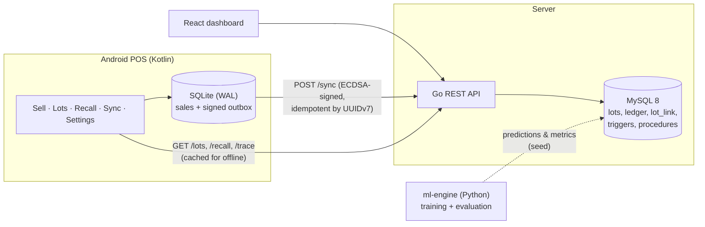

# BAN Food Intelligence

[](https://github.com/ban-food-intelligence/ban-food-intelligence/actions/workflows/ci.yml)

A working prototype for a food business: cost and stock from raw material to the final sale,
with exact lot traceability and recall. Built for the AVATAR Yapay Zeka Yarışması assessment.

- **Task 1** External production and real unit cost: 1,543.50 € / 85 packs = **18.16 € EKP**, with
  VKP, gross profit, margin and quantity variance.
- **Task 2** Whole-lamb butchery: both inconsistencies in the spec image are detected and explained
  (351.00 € declared vs 25 kg × 11.50 € = **287.50 €**; parts **22 kg** vs **25 kg** input), the cost
  is allocated by quantity or value key and always sums to the total cost, and the part lots are
  sold from the Android app.
- **Task 3** Lot traceability and recall: ET-2026-001 → URT-2026-045 → SUC-2026-045 →
  Market A / B / C (30 / 25 / 30 packs), with contacts, recorded second-tier delivery, and recalled
  lots blocked for sale on the phone (also offline).
- **AI** A: production yield + EKP forecast; B: butchery part weights per species. Both beat a
  simple baseline on a time-split test (see [docs/AI.md](docs/AI.md)). Optional: invoice reading
  with NVIDIA Nemotron VL and human approval.
- **Security** Supervisor sessions for every back-office write, ECDSA-signed POS sync with pinned
  device keys and replay detection, rate limits and PIN lockout ([docs/SECURITY.md](docs/SECURITY.md)).
- **Operations** Android recommends the earliest-expiring sellable lot per product (FEFO).
  Recall follow-up records customer contact and physical returns separately; the dashboard's
  *Assessment report (PDF)* exports the three tasks and AI evidence with Turkish text.
  See [docs/FEATURES.md](docs/FEATURES.md) for usage and the existing-database migration.

The brief: [docs/ASSESSMENT.md](docs/ASSESSMENT.md). Every bullet of it with its proof:
[docs/SPEC_COMPLIANCE.md](docs/SPEC_COMPLIANCE.md).
Sample records (lots, orders, butchery, sales, the ET-2026-001 recall): [docs/samples/](docs/samples/).

| Sell (phone) | Recall stop | Offline, sale queued | Dashboard |
|---|---|---|---|
|  |  |  |  |

Phone screenshots are from a real device (Samsung, Android 15) running against the local stack.
Every tab in TR / EN / DE, light and dark, and at 1.3× font: `docs/screenshots/android-<tab>-<lang>-<mode>.png`;
the device test flow (sale, invalid quantities, recall, offline, supervisor PIN): `android-flow-*.png`.

## Architecture



Details: [docs/ARCHITECTURE.md](docs/ARCHITECTURE.md) (data model, many-to-many lot design,
SQLite ↔ MySQL sync). API reference: [docs/API.md](docs/API.md). Terms: [docs/GLOSSARY.md](docs/GLOSSARY.md).

## Quick start

Requirements: Docker Desktop (or Podman), and for the phone app JDK 17 + Android SDK.

```bash
docker compose up -d --build        # or: make up   (Podman: make up COMPOSE="podman compose")
./scripts/demo-reset.sh             # or: make demo-reset  -> clean demo data, prints the demo path
```

| Service | URL |
|---|---|
| React dashboard | http://localhost:5173 (also :3000) |
| Go API | http://localhost:8080/health |
| MySQL | localhost:3306, database `food_intel` |

### Android app

**Without Android Studio:** download `ban-shop-pos-v1.0.0-demo.apk` from
[Releases](https://github.com/ban-food-intelligence/ban-food-intelligence/releases) and install it
(`adb install -r ban-shop-pos-v1.0.0-demo.apk`, or open the file on the phone and allow the
install). Then connect it to the API as described below (USB: `adb reverse tcp:8080 tcp:8080`).
The demo APK talks to `127.0.0.1` / the emulator host only and has invoice reading switched off
(no API key is shipped inside an app). Build it yourself with `./scripts/build-release-apk.sh`.

**From source:**

Gradle needs to find the Android SDK: set `ANDROID_HOME` (e.g. `%LOCALAPPDATA%\Android\Sdk` on
Windows, `~/Android/Sdk` on Linux) or put `sdk.dir=...` into `mobile-kotlin/local.properties`
(Android Studio does this when it opens the project).

```bash
cd mobile-kotlin
./gradlew assembleDebug             # build/outputs/apk/debug/*.apk
adb install -r build/outputs/apk/debug/*.apk
```

The app talks to `http://127.0.0.1:8080` by default:

- **USB phone:** run `adb reverse tcp:8080 tcp:8080` (or `make phone`) once after connecting.
- **Emulator:** Settings → Server → *Android emulator* (10.0.2.2), or use `adb reverse` as above.
- **Phone on Wi-Fi:** Settings → Server → *Wi-Fi network* → the computer's IP (e.g. `192.168.1.20`).
  *Test connection* shows the latency and whether the database is reachable.

Optional, in the gitignored `mobile-kotlin/local.properties`:
`NVIDIA_API_KEY=nvapi-...` (invoice reading) and `SUPERVISOR_PIN_PBKDF2=iterations:salt:hash`
(offline supervisor unlock; without it the unlock is checked online only).

## Demo credentials (demo only)

| What | Value | Notes |
|---|---|---|
| Phone supervisor PIN (Android POS) | `246813` | Releases the recall stop screen on the phone. Five wrong PINs lock the device (ten per client IP) for 5 minutes. The app's offline fallback uses a PBKDF2 hash from the gitignored `local.properties`; without it, unlock works online only. |
| Dashboard PIN (recall + back-office forms) | `246813` | Same supervisor PIN. Asked when starting a recall and when recording a receipt or butchery operation on the dashboard; for the API, `POST /auth/session` with this PIN returns the bearer token for back-office writes. |
| Both | | Demo value only. MySQL stores only its bcrypt hash (`supervisor.pin_hash`). |
| MySQL | `root` / `ban` | Local docker compose only. |

The previous supervisor PIN was committed in plain text in earlier history; it is considered
rotated and no longer works.

## Tests

```bash
./scripts/check-all.sh    # or: make check
```

Runs, then restores the clean seed. Needs the compose stack running, Python 3, JDK 17 + Android
SDK and Node 20.x / 22.x / 24+ (Vitest 4). Go, pytest and a mysql client are **not** needed on the host: Go runs in a
container, and the DB tests install pytest into `.venv` and use the mysql client inside the
compose container. Only the database tests: `./scripts/test-db.sh` (or `make test-db`).

| Suite | What it covers |
|---|---|
| `go test ./...` (api-go) | cost allocation rounding (both keys, with by-product), PIN lockout (also per IP), operator sessions, error codes, CORS, rate limit, body cap, ECDSA sync (pinned keys, mandatory signatures) |
| Go integration tests (`MYSQL_TEST_DSN`) | EKP 18.16, butchery findings, allocation sums, recording a receipt and a butchery operation with by-product, forward/backward/butchery trace, every lot movement, oversell 409, recall CSV, sync idempotency and replay mismatch, sale of a recalled lot rejected |
| `scripts/test-db.sh` (pytest, `database-mysql/tests`) | schema, triggers (no negative stock, append-only ledger, recalled lots blocked), EKP, trace, recall |
| `./gradlew testDebugUnitTest` | sale quantity validation, server address handling, recalled lots not sellable |
| `npm test` + `npm run build` (web-react) | TR/EN texts complete, supervisor-session flow; dashboard compiles |

The same suites run on every push in GitHub Actions ([ci.yml](.github/workflows/ci.yml)); the slow
ML tests run there on manual dispatch.

ML tests (separate, heavier dependencies):

```bash
python -m venv .venv-ml && .venv-ml/bin/pip install -r ml-engine/requirements.txt   # Windows: .venv-ml\Scripts\pip
.venv-ml/bin/python -m pytest ml-engine/tests -q -p no:warnings
```

## Spec requirements → where they are implemented

| Spec ([docs/ASSESSMENT.md](docs/ASSESSMENT.md)) | Implementation |
|---|---|
| Raw material cards, purchase prices, units, lots, stock | `product`, `lot`, `purchase_receipt(_line)`, `stock_balance` (schema.sql); `GET/POST /purchases` (supplier and expiry enforced), `GET /lots`; dashboard *Purchases* (list + *New receipt* form, supervisor PIN) |
| External production order, material shipment, service cost, receipt, quantity variance | `production_order/_input/_output`, `sp_production_send_input`, `sp_production_complete`; `POST /production/orders` (order + material + AI forecast), `GET/POST /production` (list, receipt); dashboard *Production* (*New production order*, *Receive finished goods*) |
| EKP from actual quantity; VKP, gross profit, margin | `v_production_cost`; 1,543.50 / 85 = 18.16 € (integration test) |
| All cost and stock movements reviewable | append-only `stock_movement` (UPDATE/DELETE blocked by triggers); `GET /movements` with running balance |
| Butchery: input lot, weight, real cost, date | `butchery_operation`; `GET /butchery`, `POST /butchery/operations` (records a new one); dashboard *Butchery* (*Record butchery* form with live weight balance and a no-save *Check*, supervisor PIN) |
| Parts, waste/by-products, weight balance | `butchery_output` (CUT / BY_PRODUCT / WASTE), `weight_check` + `WEIGHT_IMBALANCE` finding; unbalanced operations are refused |
| Cost by quantity or value key, sum = total cost | `AllocateCost` (largest remainder, unit-tested), `GET /butchery/allocation`, `allocation_ok` |
| Part lots stocked and sold from Kotlin | lots `KZB/KZS/KZO/KZK/KZY-2026-001`; Android *Sell* → `POST /sync` → `sale` + `sale_line` + SALE movement |
| Spec inconsistencies explained (287.50 vs 351.00; 22 vs 25 kg) | `DECLARED_COST_MISMATCH`, `WEIGHT_IMBALANCE` (rejected record PRC-2026-000) vs posted PRC-2026-001 |
| Supplier, lot, date, quantity, expiry on every receipt | `lot.supplier_id/supplier_lot_no/lot_date/expiry_date` |
| Many-to-many lot relations with quantities | `lot_link(parent, child, qty_consumed, qty_produced)` for production, butchery and rework |
| Transfer, sale, return, rework, waste per lot | `POST /movements/transfer|return|waste`, `POST /rework`, POS sales, `POST /shipments` (dashboard *Shipments*) |
| Forward trace: lots, stock, shipments, buyers | `sp_trace_forward`, `GET /trace/{lot}?direction=forward` |
| Backward trace: raw lots, suppliers, production orders | `sp_trace_backward`, `GET /trace/{lot}?direction=backward` |
| Recall screen blocks products; per-customer quantity, shipment, contact list; tier 2 only if recorded | `sp_recall_initiate`, `sp_recall_report`, `GET/POST /recall`, `GET /recall/contacts.csv`, dashboard *Trace & recall*; `second_tier` RECORDED / NOT_RECORDED; a customer's onward delivery is recorded with `POST /shipments` (`from_customer_code`), capped at what it received |
| Kotlin: each sale line's lot, quantity and stock movement stored; recalled lots blocked | SQLite outbox + `sale_line.stock_movement_id`; Android blocks recalled lots online and from the offline cache; recall stop with supervisor unlock |
| AI A and B with baseline and error measurement | [docs/AI.md](docs/AI.md), `GET /ai/summary`, dashboard *AI*, Android *Lots → Yield forecasts*; A is forecast live in the API for every new order |
| Traceability never from AI | trace/recall use only `lot_link`/`shipment_line`/`sale_line` |
| Optional: invoice reading with human approval | Android *Lots → Receive goods from an invoice* (NVIDIA Nemotron VL) |
| SQLite ↔ MySQL sync approach explained | [docs/ARCHITECTURE.md](docs/ARCHITECTURE.md#sqlite--mysql-sync) |
| Reports: purchase, production, butchery, lot movements, sales, recall | dashboard tabs + `docs/API.md` |
| Data model, API description, sample records, basic automated tests | ARCHITECTURE.md, API.md, [docs/samples/](docs/samples/), the test suites above |

## Repository layout

| Folder | Content |
|---|---|
| `database-mysql/` | `schema.sql` (tables, views, triggers, procedures), `seed.sql` (demo data), tests |
| `api-go/` | Go REST API |
| `web-react/` | React dashboard |
| `mobile-kotlin/` | Android POS |
| `ml-engine/` | data generator, training, evaluation (`export_ai_report.py`) |
| `scripts/` | `demo-reset.sh`, `check-all.sh`, `test-db.sh`, `export-samples.sh`, `build-release-apk.sh` |
| `docs/` | architecture, API, AI, security, spec compliance, glossary, demo script, samples, screenshots |

Team: Ali (database, ML), Berke (Go API, React), Nuri (Android POS, sync, OCR).
